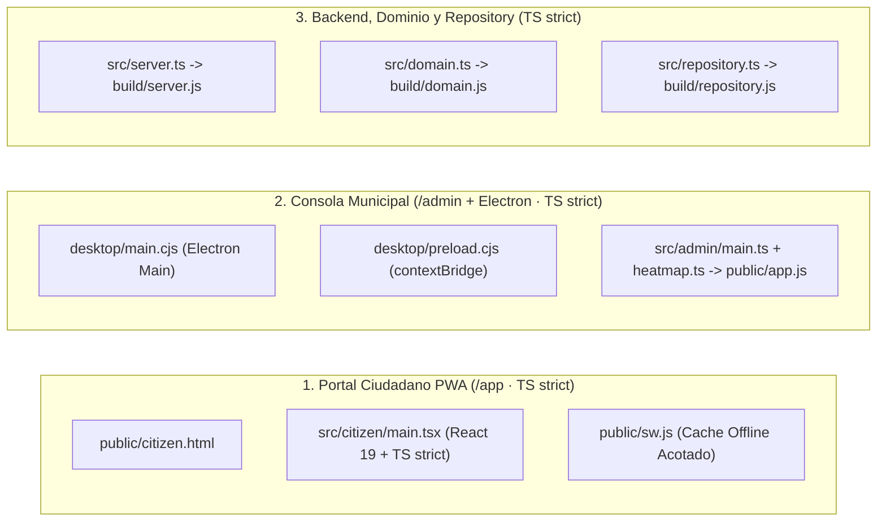
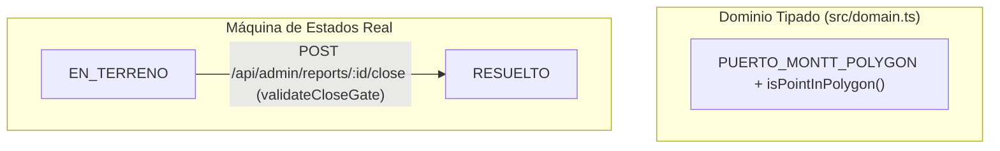

# Plataforma Cívica Inteligente Reporta Puerto Montt: Informe Técnico de Implementación, Seguridad y Pruebas del Prototipo de Software

## Portada Académica Institucional

**ÁREA DE TECNOLOGÍAS DE LA INFORMACIÓN Y CIBERSEGURIDAD**  
**CARRERA DE INGENIERÍA EN INFORMÁTICA**  
**ASIGNATURA:** INGENIERÍA DE SOFTWARE (CÓDIGO TI3043)

# PLATAFORMA CÍVICA INTELIGENTE REPORTA PUERTO MONTT
### SISTEMA INTEGRADO DE REPORTE CIUDADANO GEOLOCALIZADO Y GESTIÓN MUNICIPAL

**INFORME TÉCNICO DE IMPLEMENTACIÓN, SEGURIDAD Y PRUEBAS DEL PROTOTIPO DE SOFTWARE**  
Evaluación Sumativa Unidad 3 — Ponderación: 35% de la Calificación Final

**Equipo de Ingeniería de Software:**
- Gabriel Godoy
- Jaime Aranda
- Antonio Benedetti
- Juan Pablo Villavicencio

**Docente Guía:** Prof. José Alfredo Jara

**Estándares Técnicos y Marco Normativo de Referencia:**  
ISO/IEC/IEEE 29148:2018 · Notación UML 2.5 · W3C WCAG 2.1 Nivel AA (controles parciales) · OWASP Top 10:2021 · Ley N° 18.695 · Ley N° 19.628 · Ley N° 21.719 · Ley N° 20.285 · Ley N° 21.663

**Identificación de Configuración y Control de Versiones:**  
Repositorio Oficial: <https://github.com/ElProductor/Reporta-Puerto-montt.git> · Paquete: `reporta-puerto-montt` · Versión: `1.0.0` (`package.json`)

**Localización y Fecha de Entrega:**  
Puerto Montt, Región de Los Lagos, República de Chile — Noviembre de 2026

---

## Índice General de Contenidos

1. [Introducción y estado del proyecto](#1-introducción-y-estado-del-proyecto)  
   1.1 [Síntesis arquitectónica del sistema y objetivos operacionales vigentes](#11-síntesis-arquitectónica-del-sistema-y-objetivos-operacionales-vigentes)  
   1.2 [Insumos utilizados de la Evaluación 2 y línea base vinculante](#12-insumos-utilizados-de-la-evaluación-2-y-línea-base-vinculante)  
   1.3 [Control de cambios técnicos respecto a la arquitectura proyectada (`CAM-01` a `CAM-06`)](#13-control-de-cambios-técnicos-respecto-a-la-arquitectura-proyectada-cam-01-a-cam-06)
2. [Tecnologías, tendencias y entorno de desarrollo](#2-tecnologías-tendencias-y-entorno-de-desarrollo)  
   2.1 [Stack tecnológico real implementado y función estructural en el prototipo](#21-stack-tecnológico-real-implementado-y-función-estructural-en-el-prototipo)  
   2.2 [Análisis crítico de pertinencia: Cloud Computing, IaaS y SaaS en tecnología pública](#22-análisis-crítico-de-pertinencia-cloud-computing-iaas-y-saas-en-tecnología-pública)  
   2.3 [Requisitos de infraestructura y procedimiento de reproducción del entorno](#23-requisitos-de-infraestructura-y-procedimiento-de-reproducción-del-entorno)
3. [Arquitectura y estructura de la implementación](#3-arquitectura-y-estructura-de-la-implementación)  
   3.1 [Organización física del repositorio: módulos, archivos y dependencias](#31-organización-física-del-repositorio-módulos-archivos-y-dependencias)  
   3.2 [Auditoría frente al diseño UML de la Evaluación 2 y actualización selectiva en UML 2.5](#32-auditoría-frente-al-diseño-uml-de-la-evaluación-2-y-actualización-selectiva-en-uml-25)
4. [Construcción del prototipo y funcionalidades](#4-construcción-del-prototipo-y-funcionalidades)  
   4.1 [Módulos programados y cobertura de Casos de Uso (`CU-01` a `CU-09`)](#41-módulos-programados-y-cobertura-de-casos-de-uso-cu-01-a-cu-09)  
   4.2 [Evidencia de flujos funcionales ejecutables y código fuente real del repositorio](#42-evidencia-de-flujos-funcionales-ejecutables-y-código-fuente-real-del-repositorio)
5. [Datos e interfaces](#5-datos-e-interfaces)  
   5.1 [Interfaces desarrolladas, flujo de navegación, accesibilidad y métricas locales](#51-interfaces-desarrolladas-flujo-de-navegación-accesibilidad-y-métricas-locales)  
   5.2 [Estructura relacional normalizada (`schemaVersion: 3`), tablas y evidencia JSON](#52-estructura-relacional-normalizada-schemaversion-3-tablas-y-evidencia-json)
6. [Confidencialidad, normativa y seguridad](#6-confidencialidad-normativa-y-seguridad)  
   6.1 [Activos de datos tratados, riesgos de confidencialidad y marco jurídico chileno aplicable](#61-activos-de-datos-tratados-riesgos-de-confidencialidad-y-marco-jurídico-chileno-aplicable)  
   6.2 [Controles técnicos implementados y alineación con OWASP Top 10:2021](#62-controles-técnicos-implementados-y-alineación-con-owasp-top-102021)
7. [Plan de pruebas y casos ejecutados](#7-plan-de-pruebas-y-casos-ejecutados)  
   7.1 [Estrategia de verificación, ambiente de pruebas y datos sintéticos](#71-estrategia-de-verificación-ambiente-de-pruebas-y-datos-sintéticos)  
   7.2 [Registro maestro de casos de prueba automatizados (Tabla 5.2 — `CP-01` a `CP-31` y suites complementarias)](#72-registro-maestro-de-casos-de-prueba-automatizados-tabla-52--cp-01-a-cp-31-y-suites-complementarias)
8. [Defectos, endurecimiento técnico y nuevas pruebas](#8-defectos-endurecimiento-técnico-y-nuevas-pruebas)  
   8.1 [Registro de hallazgos y defectos corregidos en el prototipo (`HAL-01` a `HAL-08`)](#81-registro-de-hallazgos-y-defectos-corregidos-en-el-prototipo-hal-01-a-hal-08)  
   8.2 [Análisis de estabilidad transaccional y estado de preparación](#82-análisis-de-estabilidad-transaccional-y-estado-de-preparación)
9. [Trazabilidad y evaluación de cumplimiento](#9-trazabilidad-y-evaluación-de-cumplimiento)  
   9.1 [Matriz completa de trazabilidad real (`RF-01` a `RF-16` y `RNF-01` a `RNF-10`)](#91-matriz-completa-de-trazabilidad-real-rf-01-a-rf-16-y-rnf-01-a-rnf-10)  
   9.2 [Trazabilidad de Reglas de Negocio (`RN-01` a `RN-08`) y evaluación honesta frente a la rúbrica](#92-trazabilidad-de-reglas-de-negocio-rn-01-a-rn-08-y-evaluación-honesta-frente-a-la-rúbrica)
10. [Limitaciones y trabajo pendiente](#10-limitaciones-y-trabajo-pendiente)  
    10.1 [Brechas externas / de producción pendientes](#101-brechas-externas--de-producción-pendientes)  
    10.2 [Plan de preparación para la defensa de la Evaluación 4 (25%)](#102-plan-de-preparación-para-la-defensa-de-la-evaluación-4-25)
11. [Conclusiones](#11-conclusiones)
12. [Referencias Bibliográficas, Normativas y Estándares Técnicos](#referencias-bibliográficas-normativas-y-estándares-técnicos)
13. [Anexos Técnicos](#anexos-técnicos-de-reproducción-evidencias-y-verificación)  
    - [Anexo A. Variables de entorno reales y configuración local de roles RBAC](#anexo-a-variables-de-entorno-reales-y-configuración-local-de-roles-rbac)  
    - [Anexo B. Catálogo y capturas reales de evidencias de ejecución](#anexo-b-catálogo-y-capturas-reales-de-evidencias-de-ejecución)  
    - [Anexo C. Lista de verificación honesta frente a la Guía de Evaluación 3](#anexo-c-lista-de-verificación-honesta-frente-a-la-guía-de-evaluación-3)  
    - [Anexo D. Hoja oficial de registro de calificación según Rúbrica Analítica TI3043](#anexo-d-hoja-oficial-de-registro-de-calificación-según-rúbrica-analítica-ti3043)

---

## 1. Introducción y estado del proyecto

### 1.1 Síntesis arquitectónica del sistema y objetivos operacionales vigentes

El sistema **Reporta Puerto Montt** (`reporta-puerto-montt`, versión `1.0.0`) es una plataforma cívica local diseñada para canalizar reportes ciudadanos geolocalizados, conversación vecinal moderada y gestión municipal de incidencias en la comuna de Puerto Montt. Todo el código fuente propio de dominio, servidor, persistencia y ambos clientes se encuentra implementado en **TypeScript estricto** (`tsconfig.json` y `tsconfig.server.json`), organizado en tres subsistemas dentro de un único paquete Node.js:

1. **Portal Ciudadano Web / PWA (`/app`):** Aplicación React 19 escrita en TypeScript estricto (`src/citizen/main.tsx`), compilada con `esbuild` hacia `public/citizen.bundle.js` y servida desde `public/citizen.html` con soporte offline acotado mediante Service Worker (`public/sw.js`).
2. **Panel Municipal Web y de Escritorio Windows (`/admin` y Electron):** Lógica administrativa escrita en TypeScript estricto (`src/admin/main.ts` y capa térmica `src/admin/heatmap.ts`), compilada con `esbuild` hacia `public/app.js` para `public/municipal.html`, operando tanto en navegador como empaquetada en una aplicación de escritorio Electron (`desktop/main.cjs`, `desktop/preload.cjs`) con instalador Windows NSIS generado en `release-final/Reporta-Puerto-Montt-Admin-1.0.0-Setup.exe`.
3. **API Local, Dominio y Repository (`src/server.ts`, `src/repository.ts`, `src/domain.ts`):** Servidor HTTP nativo de Node.js (`node:http`) compilado hacia `build/` (arrancado desde el entrypoint `server.js`), que consume las reglas de negocio estrictas de `src/domain.ts` y abstrae el almacenamiento detrás de la interfaz `ReportRepository` (`JsonFileRepository` sobre `data/db.json` en `schemaVersion: 3`).

De acuerdo con la revisión documentada en `MATRIZ_RUBRICA.md`, **esta entrega implementa y verifica localmente todos los flujos funcionales y controles de código posibles en entorno autónomo (41/41 pruebas automatizadas aprobadas, benchmark local P95 = 261,1 ms y paquete Electron NSIS compilado)**, manteniendo absoluta transparencia respecto de las brechas que dependen de infraestructura o certificaciones externas: base de datos SQL multiusuario en servidor HTTPS institucional, SMTP/Web Push, ClaveÚnica, shapefile oficial comunal, firma digital del instalador, auditoría WCAG/pentest externa y medición real de KPIs municipales en terreno.

| ID Objetivo | Declaración del Objetivo Específico (Línea Base Informe 2) | Meta Cuantitativa Comprometida | Mecanismo Técnico Implementado en el Prototipo Actual | Estado Real Verificado |
| --- | --- | --- | --- | --- |
| **OBJ-01** | Incrementar la adopción digital ciudadana mediante una interfaz web inclusiva y guiada conforme a la Ley N° 20.500. | Tasa de adopción del 20% con flujo en ≤ 4 pasos bajo W3C WCAG 2.1 Nivel AA. | Portal PWA React 19 + TS estricto en `/app` (`src/citizen/main.tsx`) con asistente de 4 pasos, controles `min-height: 48px`, `:focus-visible`, `prefers-reduced-motion` y contraste ≥ 4.5:1 probado contra blanco. | **Parcial:** flujo de 4 pasos y controles automatizados de contraste/foco aprobados; pendiente auditoría WCAG AA completa y medición real de adopción del 20%. |
| **OBJ-02** | Disminuir el Tiempo Promedio de Respuesta (ART) municipal centralizando la recepción y despacho conforme al Art. 5° de la Ley N° 18.695. | Reducir el ART institucional a < 5.0 días hábiles. | Bandeja municipal unificada (`src/admin/main.ts` + `public/municipal.html`), asignación masiva atómica por lotes (`POST /api/admin/reports/batch`), cálculo de días hábiles (`workingDaysBetween` con feriados) y semáforo SLA. | **Parcial:** lógica de bandeja, lotes y SLA implementada y probada; el ART institucional real (< 5.0 días) **no ha sido medido** en operación municipal real. |
| **OBJ-03** | Garantizar la trazabilidad transaccional e interoperabilidad entre unidades municipales bajo ISO/IEC/IEEE 29148:2018 y Ley N° 21.180. | 100% de trazabilidad auditable en transiciones y derivaciones. | Tabla separada `events` e historial `history` en `schemaVersion: 3`, función `audit(...)` en `src/server.ts` y máquina de estados en `src/domain.ts`. | **Implementado localmente:** trazabilidad auditada en JSON local (`CP-05`, `CP-23`, `CP-24`); sin inmutabilidad forense frente a acceso físico directo al equipo. |
| **OBJ-04** | Asegurar la efectividad real de las reparaciones en terreno previniendo cierres administrativos sin respaldo técnico (Ley N° 20.285). | Tasa de resolución mensual > 85.0% con evidencia verificada. | Barrera doble cliente (`closeCase` en `src/admin/main.ts`) y servidor (`POST /api/admin/reports/:id/close` + `validateCloseGate` en `src/domain.ts`) que exige `EN_TERRENO`, nota ≥ 50 caracteres y fotografía posterior válida por Magic Bytes. | **Parcial:** bloqueo técnico verificado en `CP-29` y `CP-30`; tasa de resolución mensual real (> 85%) no medida con datos municipales reales. |
| **OBJ-05** | Optimizar la asignación presupuestaria y de cuadrillas mediante inteligencia territorial y analítica. | Reducir en un 15% el costo operativo por incidencia. | Deduplicación Haversine a ≤ 25 m (`distanceMeters`), priorización logarítmica (`priorityFor`), gráficos `Chart.js` y capa térmica HTML5 Canvas (`createCanvasHeatmapLayer` en `src/admin/heatmap.ts`). | **Parcial:** analítica, mapa de calor Canvas y deduplicación implementados; reducción del 15% en costo operativo no acreditada en operación real. |

---

### 1.2 Insumos utilizados de la Evaluación 2 y línea base vinculante

Para construir y endurecer el prototipo se utilizaron como línea base los 16 Requerimientos Funcionales (`RF-01` a `RF-16`), los 10 Requerimientos No Funcionales (`RNF-01` a `RNF-10`), las 8 Reglas de Negocio (`RN-01` a `RN-08`), las 6 Restricciones de Diseño (`RES-01` a `RES-06`) y las decisiones arquitectónicas del Informe 2:

| Categoría de Insumo (Informe 2) | Identificadores Comprendidos | Síntesis de Especificación Utilizada | Estado de Materialización Real en el Código |
| --- | --- | --- | --- |
| **Requerimientos Funcionales** | `RF-01` a `RF-16` | Asistente de 4 pasos, GPS/manual con polígono comunal, multimedia ≤ 5 MB, Haversine ≤ 25 m, mapa Leaflet, detalle Antes/Después, filtros, lotes atómicos, derivación, historial, cierre con foto + ≥ 50 chars, notificaciones, buscador folio/RUT, gráficos Chart.js, mapa de calor Canvas y RBAC. | **Implementados localmente / Parciales** (ver Sección 9.1). Pendientes externos: correo SMTP, Web Push, ClaveÚnica, shapefile oficial y servidor central multiusuario. |
| **Requerimientos No Funcionales** | `RNF-01` a `RNF-10` | Contraste/foco WCAG, P95 < 1,500 ms, diseño responsivo, privacidad + `bcryptjs` costo 12, atomicidad local, patrón Repository en 3FN, empaquetado `.exe`, cálculo SLA hábil, feedback UI y TypeScript estricto + tests. | **Código fuente 100% en TypeScript estricto** (`src/`); 41/41 tests aprobados; P95 local `261,1 ms`; `.exe` compilado (`release-final/`). Pendientes: DB SQL, firma digital y auditoría externa WCAG/pentest. |
| **Reglas de Negocio** | `RN-01` a `RN-08` | RUT Módulo 11, radio ≤ 25 m, máquina de estados, cierre foto + ≥ 50 chars, justificación ≥ 20 chars en derivación/rechazo, prioridad logarítmica, historial auditado y SLA en días hábiles descontando feriados. | **100% codificadas y probadas** en `src/domain.ts` y `src/server.ts`. |
| **Restricciones de Diseño** | `RES-01` a `RES-06` | Límite comunal Puerto Montt, dependencias Open Source (0 USD), separación ciudadano/municipal, ejecución local autónoma y esquema relacional normalizado. | **Respetadas:** polígono comunal aproximado (`PUERTO_MONTT_POLYGON`), costo 0 USD, apps separadas, interfaz `ReportRepository` lista para adaptador SQL en Fase 2. |

---

### 1.3 Control de cambios técnicos respecto a la arquitectura proyectada (`CAM-01` a `CAM-06`)

| ID Cambio | Componente Afectado | Proyección Conceptual Previa | Implementación Real en el Repositorio | Justificación Técnica del Cambio |
| --- | --- | --- | --- | --- |
| **CAM-01** | Estructura del proyecto (`package.json`) | Monorepo `npm workspaces` con 4 subpaquetes. | Paquete único Node.js (`package.json`) con separación lógica bajo `src/` (`domain.ts`, `repository.ts`, `server.ts`, `citizen/main.tsx`, `admin/main.ts`, `admin/heatmap.ts`), `public/` y `desktop/`. | Simplifica compilación (`npm run build:domain`), empaquetado Electron NSIS y reproducción determinista con `npm install && npm test`. |
| **CAM-02** | Backend HTTP (`src/server.ts`) y Persistencia (`src/repository.ts`) | Servidor Express + Zod + Multer + `write-file-atomic`. | Servidor HTTP nativo (`node:http`) compilado desde TypeScript estricto (`src/server.ts` → `build/server.js`, arrancado por `server.js`) y patrón `ReportRepository` (`JsonFileRepository`) con cola secuencial `writeQueue` y escritura atómica `${DB_FILE}.${process.pid}.tmp` + `rename`. | Minimiza dependencias en producción (solo `bcryptjs` en backend empaquetado), manteniendo tipado estricto y compatibilidad con adaptador PostgreSQL/Supabase futuro. |
| **CAM-03** | Autenticación ciudadana, sesiones y secretos (`src/server.ts`) | Formulario público sin cuenta previa y secreto fijo en `.env`. | Cuenta ciudadana obligatoria con `bcryptjs` costo 12; identidad derivada de la sesión; `supporters` guarda `rutHash` HMAC-SHA256; y `loadAuthSecret()` genera una clave aleatoria por instalación en `.auth-secret` si no se define `JWT_SECRET` (≥ 32 chars). | Impide suplantación de identidad (`CP-24`), evita RUTs en texto plano en adhesiones y elimina secretos compartidos (`tests/auth-secret.test.cjs`). |
| **CAM-04** | Migración integral a TypeScript estricto (`src/admin/*`, `src/server.ts`) | Panel municipal y servidor en JavaScript puro. | Migración completa de ambos subsistemas a TypeScript estricto (`tsconfig.json` y `tsconfig.server.json` con `strict`, `noUncheckedIndexedAccess`, `exactOptionalPropertyTypes`), compilando `public/app.js` y `build/server.js` sin alterar contratos de rutas ni pruebas. | Elimina el stack mixto en el código fuente manteniendo compatibilidad íntegra con `Electron`, `CP-03` y `tests/packaged-smoke.cjs`. |
| **CAM-05** | Geocercado Comunal y Mapa de Calor (`src/domain.ts`, `src/admin/heatmap.ts`) | BBox rectangular y marcadores circulares simples `L.circle`. | Polígono comunal aproximado de 13 vértices (`PUERTO_MONTT_POLYGON`) evaluado por Ray-Casting (`isPointInPolygon`) y capa térmica HTML5 Canvas (`createCanvasHeatmapLayer`) sobre Leaflet. | Excluye aguas abiertas y áreas cordilleranas fuera del límite comunal que el viejo rectángulo aceptaba (`CP-31`), y entrega visualización térmica continua ponderada por apoyos. |
| **CAM-06** | Empaquetado Electron (`desktop/main.cjs`, `desktop/preload.cjs`) | Cliente conectado a servidor externo. | `desktop/main.cjs` inicia `server.js` en `utilityProcess.fork` usando `app.getPath('userData')`, con `contextIsolation: true`, `sandbox: true`, `nodeIntegration: false`, bloqueo de navegación externa y `package.json` incluyendo `build/` completo en `extraResources`. | Permite generar un instalador Windows NSIS autónomo (`Reporta-Puerto-Montt-Admin-1.0.0-Setup.exe`) verificado con `tests/packaged-smoke.cjs`. |

---

## 2. Tecnologías, tendencias y entorno de desarrollo

### 2.1 Stack tecnológico real implementado y función estructural en el prototipo

| Capa / Subsistema | Tecnología / Biblioteca Real | Versión en `package.json` | Función Real Implementada en el Código |
| --- | --- | --- | --- |
| **Lenguaje Base Integral** | TypeScript | `^5.9.3` | Compila con opciones estrictas (`strict: true`, `noUncheckedIndexedAccess: true`, `exactOptionalPropertyTypes: true`, `noUnusedLocals: true`, `noUnusedParameters: true`) la totalidad del código fuente propio (`src/domain.ts`, `src/repository.ts`, `src/server.ts`, `src/citizen/main.tsx`, `src/admin/main.ts`, `src/admin/heatmap.ts`). |
| **Portal Ciudadano (Frontend PWA)** | React + React DOM + esbuild | `^19.3.1` / `^0.28.2` | Renderiza la SPA/PWA ciudadana en `/app` (`src/citizen/main.tsx` → `public/citizen.bundle.js`) con mapa, muro vecinal, asistente en 4 pasos, cuenta ciudadana, notificaciones y seguimiento. |
| **Panel Municipal (Frontend Admin)** | HTML5 + CSS3 + TypeScript (`esbuild`) | — | Código fuente en `src/admin/main.ts` y `src/admin/heatmap.ts` compilado a `public/app.js` para `public/municipal.html` (`/admin` y ventana Electron). |
| **Estilizado y Soporte Offline** | CSS nativo + Service Worker | — | `public/styles.css`, `public/offline.css` y `public/citizen-react.css`; `public/sw.js` cachea shell local y hasta 40 respuestas públicas GET (≤ 1 MB c/u). |
| **Motor Cartográfico y Calor** | Leaflet + Leaflet.markercluster + Canvas Heatmap | `^1.9.4` / `^1.5.3` | Bibliotecas locales en `public/vendor/`; `createCanvasHeatmapLayer` (`src/admin/heatmap.ts`) dibuja gradiente térmico radial sobre `<canvas>` en Leaflet. |
| **Analítica y Visualización** | Chart.js | `^4.4.7` | Almacenado localmente en `public/vendor/chartjs/chart.umd.js`; genera gráficos doughnut y de barras en `#adminAnalytics`. |
| **Consola Municipal (Desktop)** | Electron + Electron Builder | `^45.3.3` / `^26.18.0` | `desktop/main.cjs` levanta el backend compilado en `utilityProcess` y abre `/admin` en `BrowserWindow` aislado; genera `release-final/Reporta-Puerto-Montt-Admin-1.0.0-Setup.exe`. |
| **Backend Local y Seguridad** | Node.js nativo (`node:http`, `node:crypto`, `node:fs`) + `bcryptjs` | Node `>=20`, `bcryptjs ^3.0.3` | `src/server.ts` → `build/server.js` expone endpoints REST `/api/*`, tokens HMAC-SHA256, `bcryptjs` costo 12, rate limit (5 / 15 min), CORS allowlist e inspección de Magic Bytes. |
| **Pruebas Automatizadas** | Node Test Runner (`node --test`) + `tests/performance.cjs` + `tests/packaged-smoke.cjs` + `verify.ps1` | Integrado en Node.js | Ejecuta **41 pruebas repetibles** (`tests/*.test.cjs`), benchmark de 1,000 registros (`npm run perf`), smoke test sobre `release-final/win-unpacked/` y verificación en vivo con PowerShell. |

---

### 2.2 Análisis crítico de pertinencia: Cloud Computing, IaaS y SaaS en tecnología pública

- **IaaS (Infrastructure as a Service):** Provee máquinas virtuales, redes y discos (ej. AWS EC2, Azure VMs). Exige administrar sistema operativo, parches, cortafuegos y respaldo manual de base de datos, elevando el costo de operación municipal.
- **PaaS/BaaS + Entrega SaaS (Software as a Service):** Provee base de datos gestionada (ej. PostgreSQL/Supabase con PostGIS y Row Level Security) y servidor HTTPS institucional gestionado, permitiendo que ciudadanos operen desde celulares y funcionarios desde sus estaciones sin administrar servidores físicos.
- **Modelo Adoptado en este Prototipo:** Opera autónomamente en `127.0.0.1:3001` con `JsonFileRepository` (`data/db.json` o `userData` en Electron), manteniendo costo 0 USD (`RES-02`) y determinismo en evaluación. Al haber abstraído la persistencia detrás de la interfaz `ReportRepository` (`src/repository.ts`), la evolución a producción solo requiere implementar el adaptador SQL (`PostgresReportRepository`) y desplegar la API en un servidor HTTPS institucional, sin reescribir la lógica de negocio de `src/domain.ts`.

| Criterio de Evaluación | IaaS Puro (VM Linux/Windows) | SaaS / PaaS Institucional (Fase Producción) | Prototipo Local Actual (`127.0.0.1:3001` + `JsonFileRepository`) |
| --- | --- | --- | --- |
| **Costo en etapa de prototipo** | Variable / requiere tarjeta o créditos. | Capa limitada o suscripción. | **0 USD**, sin servicios externos pagos. |
| **Multiusuario real y concurrencia** | Sí (con administración manual). | Sí (ACID SQL + PostGIS/RLS). | **No:** archivo JSON local por equipo/instalación. |
| **Cartografía sin conexión** | Requiere servidor de teselas propio. | Requiere proveedor vectorial/raster autorizado. | Teselas `tile.openstreetmap.org` no se precargan offline (política OSM); sin red muestra pines sobre plano sin calles. |

---

### 2.3 Requisitos de infraestructura y procedimiento de reproducción del entorno

| Componente | Requisito Verificado | Observación Técnica |
| --- | --- | --- |
| **Sistema Operativo** | Windows 10 / Windows 11 (64 bits) | Requerido para generar y ejecutar el instalador NSIS (`release-final/Reporta-Puerto-Montt-Admin-1.0.0-Setup.exe`). |
| **Runtime** | Node.js `>= 20` + `npm` | Definido en `package.json` (`"engines": { "node": ">=20" }`). Verificado en Node.js v24.12.0. |
| **Puertos Locales** | TCP `3001` (configurable vía `PORT`) | `src/server.ts` escucha en `127.0.0.1:3001` sirviendo API, `/app` y `/admin`. |

**Secuencia exacta de comandos verificada en el repositorio:**

```powershell
# 0. Clonar el repositorio oficial
git clone https://github.com/ElProductor/Reporta-Puerto-montt.git
cd Reporta-Puerto-montt

# 1. Instalar dependencias locales
npm install

# 2. Verificar tipado estricto TypeScript (cliente/dominio y servidor/repository)
npm run typecheck

# 3. Compilar dominio/servidor/bundles y ejecutar las 41 pruebas automatizadas
npm test

# 4. Ejecutar benchmark local de rendimiento (1.000 registros, 50 clientes paralelos)
npm run perf

# 5. Generar instalador Electron Windows (.exe) y validar paquete compilado
npm run desktop:dist
node tests/packaged-smoke.cjs

# 6. Iniciar servidor web/API (http://localhost:3001/app y http://localhost:3001/admin)
npm start
```

También se dispone del lanzador rápido [Iniciar Reporta Puerto Montt.bat](file:///c:/Users/juanp/Documents/Codex/2026-11-17/ne/outputs/reporta-puerto-montt-entrega-actualizada/Iniciar%20Reporta%20Puerto%20Montt.bat) para iniciar el servicio en Windows.

---

## 3. Arquitectura y estructura de la implementación

### 3.1 Organización física del repositorio: módulos, archivos y dependencias



**Inventario exacto de archivos fuente y artefactos compilados:**

| Ruta Física en el Repositorio | Tecnología / Formato | Responsabilidad Real |
| --- | --- | --- |
| `src/domain.ts` | TypeScript estricto | Estados (`REPORT_STATUSES`), límites y polígono comunal aproximado (`PUERTO_MONTT_BOUNDS`, `PUERTO_MONTT_POLYGON`, `isPointInPolygon`, `isWithinPuertoMontt`), transiciones (`isAllowedTransition`), justificación (`requiresJustification`), RUT Módulo 11 (`validateRutModulo11`), Haversine (`distanceMeters`), prioridad (`priorityFor`), días hábiles con feriados (`workingDaysBetween`) y compuerta de cierre (`validateCloseGate`). |
| `src/repository.ts` | TypeScript estricto | Define el contrato `ReportRepository`, las interfaces de las 10 tablas (`DatabaseState`) y la implementación `JsonFileRepository` (`schemaVersion: 3`, migración automática, `normalizedSnapshot`, escritura atómica `temp` + `rename` en `writeQueue` y calendario de feriados). |
| `src/server.ts` + `server.js` | TypeScript estricto → `build/server.js` | Servidor HTTP nativo (`node:http`) con entrypoint `server.js`: autenticación ciudadana y municipal (`bcryptjs` costo 12 + tokens HMAC-SHA256), `.auth-secret`, rate limit (5 / 15 min), CORS allowlist, Magic Bytes en fotos/videos, moderación, verificación manual, lotes atómicos y métricas. |
| `src/citizen/main.tsx` | React 19 + TSX estricto | Vistas `mapa`, `Muro vecinal` (`feed`), `reportar` (4 pasos con validación territorial `isWithinPuertoMontt`), `cuenta` (registro/login, revisión institucional y buzón de notificaciones) y `seguimiento` (folio o RUT autenticado); compilado a `public/citizen.bundle.js`. |
| `src/admin/main.ts`, `src/admin/heatmap.ts` | TypeScript estricto | Lógica del panel municipal (`/admin` en `public/municipal.html`): login RBAC, bandeja, selección/asignación por lotes, expediente, cierre técnico (enviando `photo` y `media`), gráficos `Chart.js`, moderación, cola de verificación y capa térmica HTML5 Canvas (`createCanvasHeatmapLayer`); compilado a `public/app.js`. |
| `src/types/browser-globals.d.ts`, `src/types/node-builtins.d.ts` | Declaraciones TS | Contratos estrictos sin `any` para APIs de navegador (`Leaflet`, `Chart`, `reportaDesktop`) y módulos nativos de Node.js (`node:http`, `node:fs`, `node:crypto`, `node:path`, `node:url`). |
| `desktop/main.cjs`, `desktop/preload.cjs` | Electron (CommonJS) | Lanza `server.js` en `utilityProcess.fork` con `REPORTA_DATA_DIR` aislado (`userData` al empaquetar), `contextIsolation: true`, `sandbox: true`, `nodeIntegration: false` y `window.reportaDesktop`. |
| `tests/*.test.cjs`, `tests/performance.cjs`, `tests/packaged-smoke.cjs`, `verify.ps1` | Node Test / PowerShell | 41 pruebas automatizadas (`api`, `domain`, `accessibility`, `auth-secret`, `offline`), benchmark de 1,000 casos, smoke test de `release-final/win-unpacked/` y verificación en vivo PowerShell. |

---

### 3.2 Auditoría frente al diseño UML de la Evaluación 2 y actualización selectiva en UML 2.5

Frente al diseño del Informe 2, los Casos de Uso y la Máquina de Estados incorporan cuenta ciudadana, moderación vecinal, buzón privado y verificación institucional manual; a nivel de Componentes y Despliegue, la arquitectura refleja la migración completa de código propio a TypeScript estricto (`src/`), el patrón `ReportRepository` (`src/repository.ts`) y el empaquetado Electron NSIS (`release-final/`):



---

## 4. Construcción del prototipo y funcionalidades

### 4.1 Módulos programados y cobertura de Casos de Uso (`CU-01` a `CU-09`)

| Caso de Uso | Archivos Reales Involucrados | Entradas Procesadas | Procesamiento y Reglas Aplicadas | Salidas y Errores Reales |
| --- | --- | --- | --- | --- |
| **CU-01 / CU-02:** Registro Geolocalizado y Deduplicación | `src/citizen/main.tsx`, `src/domain.ts`, `src/server.ts` | `lat`, `lng`, `category`, `description` (10–1,500 chars), `photo`, `media` (1–3 archivos, ≤ 5 MB), sesión ciudadana. | Verifica polígono comunal (`isWithinPuertoMontt`), RUT de sesión (`validateRutModulo11`), firma binaria (`validateMedia`) y duplicados activos a `<= 25` m (`distanceMeters`). | `201 Created` con folio `RPM-YYYY-XXXX` y notificación en buzón; `400` fuera de polígono (`CP-31`); `409` duplicado ≤ 25 m o doble apoyo. |
| **CU-03 / CU-04:** Mapa, Muro Vecinal, Filtros, Comentarios y Seguimiento | `src/citizen/main.tsx` (`MapView`, `ReportDetail`, `ReportSummary`), `src/server.ts` | Búsqueda texto, estado, folio, o sesión ciudadana para `POST /api/track`. | `publicReport()` suprime PII del reportante y notas internas; filtros reactivos `useMemo`; comentarios filtran emails/RUTs/teléfonos y entran como `PENDIENTE`. | Mapa Leaflet con pines cromáticos, muro vecinal con media, modal detalle Antes/Después, seguimiento por folio y por cuenta/RUT. |
| **CU-05 / CU-06 / CU-09:** Login RBAC, Lotes y Derivación | `public/municipal.html`, `src/admin/main.ts`, `src/server.ts`, `src/domain.ts` | Credenciales (`email`, `password`), lote `ids` (1–100), `status`, `department`, `comment`. | Verifica `bcryptjs` (12) + token HMAC; rate limit 5 / 15 min; restringe `INSPECTOR_DEPTO` a su departamento; exige justificación ≥ 20 chars en `DERIVADO`/`RECHAZADO`; prevalida todo el lote antes de mutar y revierte ante fallo. | `200 OK` con actualización atómica y registros en `events` y `notifications`; `403`/`409`/`400`/`429` según regla violada. |
| **CU-07:** Cierre Técnico Verificado | `src/admin/main.ts` (`openAdminDetail`, `closeCase`), `src/domain.ts` (`validateCloseGate`), `src/server.ts` | `text` (≥ 50 chars), `crew`, `photo` posterior (`JPG`/`PNG`/`WebP`, ≤ 5 MB) y `media`. | Exige rol `INSPECTOR_DEPTO` o `ADMIN_MUNICIPAL`, estado `EN_TERRENO`, `validateCloseGate`, rechazo de datos de contacto/RUT y validación binaria de imagen (soporta payload con o sin `media` redundante, verificado en `CP-30`). | Transición a `RESUELTO`, cálculo de `workdays` con feriados, evento en `events` y notificación ciudadana. |
| **CU-08:** Analítica y Mapa de Calor Canvas | `src/admin/main.ts` (`renderMetrics`, `drawCharts`, `initHeat`), `src/admin/heatmap.ts`, `src/server.ts` | Reportes, `events` y feriados `HOLIDAYS`. | Calcula totales, abiertos, resueltos, tasa de resolución, promedio de días hábiles y puntos activos ponderados por `(supporters.length + 1)`. | Tarjetas KPI, 2 gráficos `Chart.js` y capa térmica radial HTML5 Canvas (`createCanvasHeatmapLayer`) con popups clicables. |
| **Extensión (Moderación y Verificación):** | `src/citizen/main.tsx`, `src/admin/main.ts`, `src/server.ts` | Comentarios vecinales y solicitudes `/api/citizens/verification-request`. | `ADMIN_MUNICIPAL` modera comentarios (`PATCH /api/admin/comments/:id`) y resuelve solicitudes de verificación (`PATCH /api/admin/verification-requests/:id`). | Comentarios publicados como `"Vecino/a"` y actualización de `identityVerified`. |

**Separación explícita de interfaces y flujos de acceso (Usuario Ciudadano vs. Administrador Municipal):**

| Dimensión | Interfaz de Usuarios — Portal Ciudadano PWA (`/app`) | Interfaz de Administrador — Consola Municipal (`/admin` / Electron) |
| --- | --- | --- |
| **Entrada y Autenticación** | Pestaña **Mi cuenta** (`citizen-login-card`): **Iniciar sesión** (correo + contraseña) y **Crear cuenta** (Nombre completo + **RUT validado con Módulo 11** + correo + contraseña). Endpoint `POST /api/citizens/login` y `POST /api/citizens/register`. | Pantalla **Gestión municipal** (`#loginForm`): **Acceso institucional RBAC** restringido por correo corporativo y contraseña (`OPERADOR_MESA`, `INSPECTOR_DEPTO`, `ADMIN_MUNICIPAL`), sin registro abierto. Endpoint `POST /api/auth/login`. |
| **Navegación y Secciones** | Barra superior de 5 secciones: **Mapa**, **Muro vecinal**, **Reportar** (asistente de 4 pasos), **Mi cuenta** y **Seguimiento**. | Barra institucional con subpestañas **Bandeja de reportes** (gestión individual y por lotes + cierre técnico) y **Analítica** (`Chart.js` + Mapa de calor Canvas + moderación). |
| **Evidencia Visual** | Anexo B, Subsección **B.2** (`Capturas B.2 a B.8`). | Anexo B, Subsección **B.3** (`Capturas B.9 a B.11`). |

---

### 4.2 Evidencia de flujos funcionales ejecutables y código fuente real del repositorio

#### Flujo Funcional 1: Validación Territorial por Polígono Comunal y Compuerta de Cierre (`src/domain.ts`)

```ts
// Archivo real: src/domain.ts (polígono comunal aproximado y ray-casting)
export function isPointInPolygon(point: Coordinates, polygon: readonly Coordinates[]): boolean {
  const count = polygon.length;
  if (count < 3) return false;
  let inside = false;
  for (let i = 0, j = count - 1; i < count; j = i++) {
    const vi = polygon[i];
    const vj = polygon[j];
    if (!vi || !vj) continue;
    const intersects = (vi.lat > point.lat) !== (vj.lat > point.lat)
      && point.lng < ((vj.lng - vi.lng) * (point.lat - vi.lat)) / (vj.lat - vi.lat) + vi.lng;
    if (intersects) inside = !inside;
  }
  return inside;
}

export function isWithinPuertoMontt(coordinates: Coordinates): boolean {
  const { lat, lng } = coordinates;
  if (
    !Number.isFinite(lat)
    || !Number.isFinite(lng)
    || lat < PUERTO_MONTT_BOUNDS.minLat
    || lat > PUERTO_MONTT_BOUNDS.maxLat
    || lng < PUERTO_MONTT_BOUNDS.minLng
    || lng > PUERTO_MONTT_BOUNDS.maxLng
  ) {
    return false;
  }
  return isPointInPolygon(coordinates, PUERTO_MONTT_POLYGON);
}
```

#### Flujo Funcional 2: Cierre Técnico y Capa Térmica Canvas en Consola Municipal (`src/admin/main.ts` y `src/admin/heatmap.ts`)

```ts
// Archivo real: src/admin/main.ts (cierre técnico corregido con envío explícito de photo y media)
async function closeCase(id0: string): Promise<void> {
  const errEl = $('#closeError');
  if (errEl) errEl.textContent = '';
  const text = ($<HTMLTextAreaElement>('#closureText')?.value ?? '').trim();
  if (text.length < 50) {
    if (errEl) errEl.textContent = 'El informe debe tener al menos 50 caracteres.';
    return;
  }
  if (!closurePhotoData) {
    if (errEl) errEl.textContent = 'La foto posterior es obligatoria.';
    return;
  }
  try {
    await api(`/api/admin/reports/${id0}/close`, {
      method: 'POST',
      body: JSON.stringify({
        text,
        crew: $<HTMLInputElement>('#closureCrew')?.value ?? '',
        photo: closurePhotoData,
        media: [{ type: closurePhotoType, data: closurePhotoData }],
      }),
    });
    closurePhotoData = null;
    toast('Caso resuelto y notificación disponible en seguimiento.');
    const detailContainer = $('#adminDetail');
    if (detailContainer) detailContainer.innerHTML = '';
    await refreshAdmin();
    await reloadPublic();
  } catch (err) {
    if (errEl) errEl.textContent = err instanceof Error ? err.message : 'Error al cerrar el caso.';
  }
}
```

#### Flujo Funcional 3: Persistencia Desacoplada y Prevalidación Atómica (`src/repository.ts` y `src/server.ts`)

```ts
// Archivo real: src/repository.ts (contrato Repository y escritura atómica)
export interface ReportRepository {
  load(): DatabaseState;
  persist(state: DatabaseState): Promise<void>;
  loadHolidayCalendar(): Set<string>;
}

public persist(state: DatabaseState): Promise<void> {
  const snapshot = JSON.stringify(this.normalizedSnapshot(state), null, 2);
  this.writeQueue = this.writeQueue
    .catch(() => undefined)
    .then(async () => {
      const temp = `${this.dbFile}.${process.pid}.tmp`;
      await fs.promises.writeFile(temp, snapshot);
      await fs.promises.rename(temp, this.dbFile);
    });
  return this.writeQueue;
}
```

---

## 5. Datos e interfaces

### 5.1 Interfaces desarrolladas, flujo de navegación, accesibilidad y métricas locales

1. **Portal Ciudadano (`/app`, React 19 + TS estricto):**
   - Cinco vistas (`Mapa`, `Muro vecinal`, `Reportar`, `Mi cuenta`, `Seguimiento`), estado de conexión (`En línea` / `Sin conexión`) e instalación PWA.
   - **Accesibilidad verificable (`tests/accessibility.test.cjs`):** contraste ≥ `4.5:1` contra blanco (`public/styles.css`), `:focus-visible` (`outline: 3px`), controles táctiles `min-height: 48px` y `@media (prefers-reduced-motion: reduce)` (`public/citizen-react.css`). **No cuenta con auditoría WCAG 2.1 AA completa independiente.**
2. **Panel Municipal (`/admin` y Electron, TypeScript estricto → `public/app.js`):**
   - Login RBAC, bandeja con filtros, selección múltiple por lotes, semáforo SLA hábil, expediente con transiciones y cierre técnico, gráficos `Chart.js`, capa térmica radial Canvas (`src/admin/heatmap.ts`), moderación de comentarios y verificación institucional.
3. **Rendimiento medido localmente en esta sesión (`tests/performance.cjs`):**
   - Ejecución de `npm run perf` sobre `build/server.js` con 1,000 registros sintéticos, 50 clientes paralelos y 200 solicitudes `GET /api/reports`: **P95 = 261,1 ms** y **media = 154,3 ms** (por debajo del umbral de `1,500 ms`, `pass: true`, ver Evidencia `EV-03` en Anexo B). *Nota: corresponde a medición local sintética y no acredita 1,000 usuarios concurrentes ni red municipal real. Tampoco se han medido KPIs reales de operación municipal (ART, tasa mensual, adopción o ahorro).*

---

### 5.2 Estructura relacional normalizada (`schemaVersion: 3`), tablas y evidencia JSON

La clase `JsonFileRepository` (`src/repository.ts`) persiste `data/db.json` bajo `schemaVersion: 3` con **10 tablas normalizadas vinculadas por ID**: `reports`, `citizens`, `reporters`, `staff`, `supporters` (almacena `rutHash` HMAC-SHA256 de 64 hex), `events`, `reportComments`, `reportMedia`, `notifications` y `verificationRequests`.

```json
{
  "schemaVersion": 3,
  "tables": {
    "reports": [
      {
        "id": "uuid-reporte",
        "folio": "RPM-2026-0001",
        "category": "Alumbrado público",
        "description": "Caso sintético de prueba...",
        "lat": -41.45,
        "lng": -72.9,
        "status": "RESUELTO",
        "department": "Operaciones",
        "createdAt": "2026-11-16T12:00:00.000Z",
        "updatedAt": "2026-11-17T12:00:00.000Z",
        "severity": 2,
        "closure": {
          "text": "Trabajo realizado y validado en el lugar.",
          "crew": "Cuadrilla de prueba",
          "closedAt": "2026-11-17T12:00:00.000Z"
        },
        "reporterId": "uuid-ciudadano"
      }
    ],
    "citizens": [],
    "reporters": [],
    "staff": [],
    "supporters": [{ "reportId": "uuid-reporte", "rutHash": "64-hex-hmac-sha256" }],
    "events": [],
    "notifications": [],
    "reportComments": [],
    "reportMedia": [],
    "verificationRequests": []
  }
}
```

---

## 6. Confidencialidad, normativa y seguridad

### 6.1 Activos de datos tratados, riesgos de confidencialidad y marco jurídico chileno aplicable

El sistema separa tres clases de información: (1) **datos personales ciudadanos (PII)** en `citizens`/`reporters`, (2) **credenciales y auditoría municipal** en `staff`/`events`, y (3) **información pública urbana** en `publicReport()`. Esta arquitectura aplica el principio de minimización y reserva de la **Ley N° 19.628** y **Ley N° 21.719**, junto con el principio de divisibilidad de la **Ley N° 20.285** (publicando el avance, fotos antes/después e informe técnico sin exponer RUT, nombre ni contacto del vecino, y sanitizando comentarios del historial público con `publicHistoryComment`), en coherencia con la **Ley N° 21.663** y la **Ley N° 18.695**. *No sustituye un dictamen jurídico ni auditoría formal externa.*

---

### 6.2 Controles técnicos implementados y alineación con OWASP Top 10:2021

| Categoría OWASP Top 10:2021 | Amenaza en Reporta Puerto Montt | Control Real Implementado | Ubicación Verificable |
| --- | --- | --- | --- |
| **A01 – Broken Access Control** | Filtración de PII o ejecución de acciones fuera de rol/departamento. | `publicReport()` omite PII y notas internas; `auth(req, roles)` y `citizenAuth(req)` validan Bearer HMAC-SHA256; restricción departamental para `INSPECTOR_DEPTO`; creación de reportes restringida a sesión ciudadana. | `src/server.ts` |
| **A02 – Cryptographic Failures** | Claves débiles, secretos compartidos o RUTs en claro en apoyos. | `bcryptjs` costo 12 (con migración desde scrypt al login); secreto aleatorio por instalación en `.auth-secret` (rechaza `JWT_SECRET` < 32 chars); `rutHash` HMAC-SHA256 en `supporters`. | `src/server.ts`, `src/repository.ts`, `tests/auth-secret.test.cjs` |
| **A03 – Injection / XSS** | Archivos falsificados o inyección HTML/PII. | Inspección binaria de Magic Bytes (JPG, PNG, WebP, MP4, WebM) en `validateMedia()` y `/close`; escape HTML `esc()` en `src/admin/main.ts` y escape JSX en React 19; rechazo de emails/RUTs/teléfonos en comentarios e informes. | `src/server.ts`, `src/admin/main.ts`, `src/citizen/main.tsx` |
| **A04 – Insecure Design** | Cierres falsos, duplicidad ≤ 25 m o suplantación en formulario. | `validateCloseGate` en TS; Haversine ≤ 25 m; identidad tomada de la sesión ciudadana (`CP-24`); polígono comunal `PUERTO_MONTT_POLYGON` (`CP-31`). | `src/domain.ts`, `src/server.ts` |
| **A05 – Security Misconfiguration** | Fuerza bruta, CORS abierto o escape Electron. | Rate limit 5 intentos / 15 min (`429`); CORS cerrado por defecto (`CORS_ORIGINS`); Electron con `contextIsolation: true`, `sandbox: true`, `nodeIntegration: false`, bloqueo de ventanas/navegación externa y permiso limitado a `geolocation`. | `src/server.ts`, `desktop/main.cjs` |
| **A09 – Logging and Monitoring Failures** | Pérdida de trazabilidad o lotes a medias. | Tabla `events` e historial vía `audit()`, prevalidación completa de lotes y persistencia atómica temporal + `rename`. *(Limitación: JSON local no ofrece inmutabilidad forense física).* | `src/server.ts`, `src/repository.ts` |

> **Brecha declarada:** Las pruebas locales no equivalen a un pentest externo completo, y el instalador Windows generado en `release-final/` no posee firma digital de código institucional (por lo que Windows puede advertir editor desconocido).

---

## 7. Plan de pruebas y casos ejecutados

### 7.1 Estrategia de verificación, ambiente de pruebas y datos sintéticos

Todas las verificaciones se ejecutaron en el entorno local Windows (Node.js v24.12.0) tras la última edición del código, utilizando datos sintéticos aislados en directorios temporales (`mkdtemp`) y compilando previamente `tsc` y `esbuild`:

- **`npm run typecheck`:** Aprobado con **0 errores** en `tsconfig.json` (portal ciudadano, panel municipal, capa térmica, dominio) y `tsconfig.server.json` (servidor HTTP, repositorio, dominio).
- **`npm test`:** **41/41 pruebas aprobadas** (`0` fallidas, `0` omitidas): **31** pruebas HTTP (`CP-01` a `CP-31` en `tests/api.test.cjs`), **6** unitarias de dominio (`tests/domain.test.cjs`), **2** de accesibilidad CSS (`tests/accessibility.test.cjs`), **1** de aislamiento criptográfico (`tests/auth-secret.test.cjs`) y **1** de shell/caché offline (`tests/offline.test.cjs`).
- **`npm run perf`:** **Aprobado** (`P95 = 261.1 ms`, `mean = 154.3 ms`, umbral `< 1500 ms` sobre 1,000 registros y 50 clientes paralelos; Evidencia `EV-03`).
- **`npm run desktop:dist` + `node tests/packaged-smoke.cjs`:** Instalador Windows generado en `release-final/Reporta-Puerto-Montt-Admin-1.0.0-Setup.exe` y smoke test empaquetado **aprobado**.
- **`./verify.ps1`:** Ejecutado contra instancia local en puerto `3001`, con todas las aserciones PowerShell aprobadas (`PASS`).

---

### 7.2 Registro maestro de casos de prueba automatizados (Tabla 5.2 — `CP-01` a `CP-31` y suites complementarias)

> **Precondición general del banco de pruebas:** Antes de cada suite (`tests/*.test.cjs`), el proceso de prueba compila TypeScript estricto (`npm run build:domain`), inicia `build/server.js` sobre un directorio de datos temporal limpio (`mkdtemp`) sembrado con 50 reportes sintéticos (`schemaVersion: 3`), calendario de feriados configurado (`REPORTA_HOLIDAYS`) y clave aleatoria por instalación (`.auth-secret`), aislando las ejecuciones para garantizar repetibilidad determinista.

| ID / Requisito | Pasos y Datos de Entrada (`tests/api.test.cjs`) | Resultado Esperado | Resultado Observado | Estado / Evidencia |
| --- | --- | --- | --- | --- |
| **CP-01** / `RNF-08` | Invocar `GET /api/health` contra el servidor local iniciado. | HTTP `200 OK` con `{ ok: true }`. | Respuesta `ok: true` inmediata confirmando servicio activo. | **Aprobado** / `EV-02` |
| **CP-02** / `RF-01`, `RF-05` | Solicitar `GET /app`, `GET /citizen.bundle.js` y `GET /citizen-react.css`. | Entrega HTML PWA React 19 y bundle sin `app.js`. | HTML, bundle y CSS servidos (`200 OK`). | **Aprobado** / `EV-02`, `EV-04` |
| **CP-03** / `RF-08`, `RES-03` | Solicitar `GET /admin` y verificar carga de `/app.js`. | Entrega consola administrativa sin `citizenRoot`. | Interfaz municipal y script servidos (`200 OK`). | **Aprobado** / `EV-02`, `EV-05` |
| **CP-04** / `RF-01`, `RF-02` | Invocar `GET /api/meta`. | Catálogo `>= 6` categorías y límites (`minLat < maxLat`). | JSON con categorías y `PUERTO_MONTT_BOUNDS` (`200 OK`). | **Aprobado** / `EV-02` |
| **CP-05** / `RNF-06`, `RES-05` | Iniciar servidor con semilla limpia e inspeccionar `data/db.json`. | ≥ 50 reportes en `schemaVersion: 3` y `>= 50` eventos separados. | `db.json` creado con 50 reportes y 10 tablas normalizadas. | **Aprobado** / `EV-02` |
| **CP-06** / `RF-05`, `RF-07` | Invocar `GET /api/reports` y revisar estados retornados. | Lista pública excluye casos en estado `RECHAZADO`. | 0 reportes `RECHAZADO` en respuesta pública. | **Aprobado** / `EV-02` |
| **CP-07** / `RF-04`, `RN-02` | Enviar `POST /api/reports/duplicate` con coordenada y categoría activas. | Detección Haversine `<= 25 m` retornando el reporte activo. | Duplicado detectado (`200 OK`). | **Aprobado** / `EV-02` |
| **CP-08** / `RF-04`, `RNF-09` *(Neg.)* | Enviar `POST /api/reports/duplicate` con `{ lat: -41.4, lng: -72.9, category: 'invalid' }`. | Rechazo HTTP `400 Bad Request` por categoría inválida. | API responde `400` con mensaje de validación. | **Aprobado** / `EV-02` |
| **CP-09** / `RF-13`, `RNF-04` | Consultar `GET /api/reports/:folio` para un reporte existente. | Retorna detalle público sin `citizen` (ni RUT, nombre o email). | `report.citizen === undefined` (`200 OK`). | **Aprobado** / `EV-02` |
| **CP-10** / `RF-06` | Consultar `GET /api/reports/:folio/comments`. | HTTP `200 OK` con arreglo de comentarios publicados. | Lista de comentarios públicos entregada (`200 OK`). | **Aprobado** / `EV-02` |
| **CP-11** / `RNF-09` *(Neg.)* | Enviar `POST /api/reports/:folio/comments` con `{ text: 'no' }` autenticado. | Rechazo HTTP `400` por longitud `< 5` caracteres. | Comentario rechazado con estado `400`. | **Aprobado** / `EV-02` |
| **CP-12** / `RNF-04` *(Neg.)* | Enviar `POST /api/reports/:folio/comments` con `{ text: 'Contacta vecino@mail.com' }`. | Rechazo HTTP `400` por filtro anti-PII en comentarios. | Publicación bloqueada con estado `400`. | **Aprobado** / `EV-02` |
| **CP-13** / `RNF-04`, `RF-16` | Crear comentario seguro (`201`), moderar vía `PATCH /api/admin/comments/:id` (`PUBLICADO`) y leer público. | Comentario visible sin `citizenId` y autor `Vecino/a`. | Moderación `200 OK` y autor público igual a `Vecino/a`. | **Aprobado** / `EV-02` |
| **CP-14** / `RF-16` | Enviar `POST /api/auth/login` con credenciales locales válidas de `ADMIN_MUNICIPAL`. | HTTP `200 OK` con token Bearer y rol `ADMIN_MUNICIPAL`. | Token emitido y rol `ADMIN_MUNICIPAL` verificado. | **Aprobado** / `EV-02` |
| **CP-15** / `RF-16` *(Neg.)* | Enviar `POST /api/auth/login` con contraseña `'incorrecta'`. | Rechazo HTTP `401 Unauthorized`. | Servidor responde `401` ante clave errónea. | **Aprobado** / `EV-02` |
| **CP-16** / `RF-14`, `RF-16` *(Neg.)* | Invocar `GET /api/admin/metrics` sin cabecera `Authorization`. | Rechazo HTTP `401 Unauthorized`. | Acceso denegado con estado `401`. | **Aprobado** / `EV-02` |
| **CP-17** / `RF-14` | Invocar `GET /api/admin/metrics` con token de administrador. | HTTP `200 OK` con `total >= 50`. | Métricas entregadas con `total >= 50`. | **Aprobado** / `EV-02` |
| **CP-18** / `RF-08`, `RF-16` *(Neg.)* | Invocar `GET /api/admin/reports` de forma anónima. | Rechazo HTTP `401 Unauthorized`. | Petición bloqueada con código `401`. | **Aprobado** / `EV-02` |
| **CP-19** / `RF-08` | Invocar `GET /api/admin/reports` con token municipal válido. | HTTP `200 OK` retornando `>= 50` expedientes. | Bandeja administrativa recibida (`>= 50`). | **Aprobado** / `EV-02`, `EV-05` |
| **CP-20** / `RF-12`, `RF-13` *(Neg.)* | Invocar `POST /api/track`, `GET /api/admin/verification-requests` y `GET /api/citizens/notifications` sin token. | Rechazo HTTP `401 Unauthorized` en los 3 endpoints privados. | Los 3 endpoints rechazan acceso anónimo con `401`. | **Aprobado** / `EV-02`, `HAL-02` |
| **CP-21** / `RF-08`, `RNF-05` *(Neg.)* | Ejecutar `POST /api/admin/reports/batch` con `[idValido, 'missing-id']`. | HTTP `404` y **0 mutaciones** en el caso válido del lote. | Lote abortado (`404`); estado previo intacto en `db.json`. | **Aprobado** / `EV-02`, `HAL-05` |
| **CP-22** / `RN-03`, `RNF-05` *(Neg.)* | Ejecutar lote mezclando un caso `PENDIENTE` y uno `RESUELTO`. | HTTP `409 Conflict` y *rollback* total sin mutaciones. | Rechazo `409` verificado; el caso `PENDIENTE` no cambia. | **Aprobado** / `EV-02`, `HAL-05` |
| **CP-23** / `RF-08`, `RF-10` | Ejecutar lote válido de 2 reportes `PENDIENTE` hacia `EN_REVISION`. | HTTP `200 OK`, `updated: 2` y `+2` eventos en `events`. | Transición masiva atómica aplicada y auditada (`+2`). | **Aprobado** / `EV-02`, `HAL-05` |
| **CP-24** / `RF-01..04`, `RF-09`, `RF-12`, `RF-16` | RBAC depto. (`403`), creación anónima (`401`), fuera de límites (`400`), creación autenticada (`201`), notificaciones, apoyo (`200`), doble apoyo (`409`) y `rutHash`. | RBAC estricto, identidad tomada de la sesión ciudadana, buzón actualizado, bloqueo de doble apoyo y `rutHash` de 64 hex. | `403`, `401`, `400`, `201`, notificaciones leídas, apoyo `200` / `409` y `rutHash` de 64 chars en `supporters`. | **Aprobado** / `EV-02`, `HAL-02` |
| **CP-25** / `RNF-04` *(CORS)* | Enviar `GET /api/health` con `Origin: https://portal.example.test` vs. `https://evil.example`. | Permite origen en `CORS_ORIGINS` y omite header en origen no autorizado. | `access-control-allow-origin` emitido solo al origen autorizado. | **Aprobado** / `EV-02` |
| **CP-26** / `RNF-08`, `RN-08` | Consultar `GET /api/meta` y `GET /api/admin/metrics` con `REPORTA_HOLIDAYS='2026-11-17'`. | Descuenta feriados del cálculo de días hábiles (`averageWorkdays: 0`). | Feriado reconocido en `meta.holidays` y `averageWorkdays === 0`. | **Aprobado** / `EV-02`, `HAL-06` |
| **CP-27** / `RF-16` *(Fuerza Bruta)* | Realizar 6 intentos fallidos consecutivos en `POST /api/auth/login`. | Bloqueo temporal con HTTP `429 Too Many Requests` tras 5 fallos. | Al 5° y 6° intento devuelve HTTP `429`. | **Aprobado** / `EV-02` |
| **CP-28** / `RNF-04` *(Criptografía)* | Inspeccionar `staff` y `citizens` en `data/db.json`. | Todas las contraseñas almacenadas con `bcrypt` costo 12. | 100% de hashes cumplen `/^\$2[aby]\$12\$/`. | **Aprobado** / `EV-02` |
| **CP-29** / `RF-11`, `RN-04` *(Pos. y Neg.)* | Invocar `POST /api/admin/reports/:id/close` con nota corta (`400`), sin foto (`400`) y con foto JPEG + nota ≥ 50 chars (`200`). | Bloqueo estricto ante falta de foto o nota corta; `RESUELTO` al cumplir ambos. | Rechazos `400` verificados y cierre válido en `200 OK` (`RESUELTO`). | **Aprobado** / `EV-02`, `HAL-06` |
| **CP-30** / `RF-11`, `HAL-08` | Inspeccionar `/app.js` y enviar `POST /api/admin/reports/:id/close` solo con `photo` válida y nota ≥ 50 chars. | Sin `useManualCoords).onclick` roto; incluye `media` en bundle y servidor acepta `photo` sin `media` duplicado. | Bundle limpio y cierre completado a `RESUELTO` (`200 OK`). | **Aprobado** / `EV-02`, `EV-05`, `HAL-08` |
| **CP-31** / `RF-02`, `RES-01` *(Neg.)* | Consultar `GET /api/meta` y enviar `POST /api/reports` en `(-41.63, -73.22)` (dentro del BBox rectangular pero fuera de `PUERTO_MONTT_POLYGON`). | Polígono `>= 10` vértices expuesto y rechazo HTTP `400` por algoritmo *Ray-Casting*. | API rechaza la coordenada con estado `400` (`/límite comunal/`). | **Aprobado** / `EV-02`, `EV-04`, `HAL-07` |

**Suites complementarias verificadas (10 pruebas unitarias/estáticas + rendimiento + paquete + PowerShell):**
- `tests/domain.test.cjs` (**6/6 aprobadas**): incluye validación de polígono comunal excluyendo mar abierto/cordillera dentro del viejo BBox.
- `tests/accessibility.test.cjs` (**2/2 aprobadas**), `tests/auth-secret.test.cjs` (**1/1 aprobada**), `tests/offline.test.cjs` (**1/1 aprobada**).
- `tests/performance.cjs` (`P95 = 261.1 ms`, `mean = 154.3 ms`), `tests/packaged-smoke.cjs` (**aprobado**) y `verify.ps1` (**12/12 PASS**).

---

## 8. Defectos, endurecimiento técnico y nuevas pruebas

### 8.1 Registro de hallazgos y defectos corregidos en el prototipo (`HAL-01` a `HAL-08`)

| ID | Hallazgo / Defecto Detectado | Corrección Implementada en Código | Prueba / Verificación | Estado |
| --- | --- | --- | --- | --- |
| **HAL-01** | Secreto de sesión compartido por defecto en entorno local. | `loadAuthSecret()` en `src/server.ts` genera `.auth-secret` aleatorio por instalación (`0o600`) o exige `JWT_SECRET >= 32` chars. | `tests/auth-secret.test.cjs` | **Cerrado** |
| **HAL-02** | Reportes/apoyos sin sesión ciudadana obligatoria ni hashing de RUTs adherentes. | Sesión ciudadana obligatoria derivada del token; `supporters` almacena `rutHash` HMAC-SHA256 (`PII_HASH_SECRET`). | `CP-20`, `CP-24` | **Cerrado** |
| **HAL-03** | Persistencia JSON sin normalización relacional. | `JsonFileRepository` (`src/repository.ts`) con 10 tablas normalizadas (`schemaVersion: 3`) y escritura atómica temporal + `rename`. | `CP-05`, `CP-24` | **Cerrado** |
| **HAL-04** | Portal ciudadano sin PWA TS independiente ni buzón privado. | `src/citizen/main.tsx` (React 19 + TS estricto), buzón `/api/citizens/notifications` y `public/sw.js` con caché acotado. | `CP-02`, `CP-24`, `tests/offline.test.cjs` | **Cerrado** |
| **HAL-05** | Asignación por lotes sin prevalidación integral ni rollback. | Prevalidación del lote completo en `POST /api/admin/reports/batch` con rollback en memoria en caso de error. | `CP-21`, `CP-22`, `CP-23` | **Cerrado** |
| **HAL-06** | SLA sin feriados configurables y validación parcial de medios. | Feriados configurables (`data/feriados.json` / `REPORTA_HOLIDAYS`), Magic Bytes en fotos/videos y `validateCloseGate`. | `CP-26`, `CP-29`, `verify.ps1` | **Cerrado** |
| **HAL-07** | Stack mixto JS/TS en servidor y panel `/admin`, BBox rectangular y mapa de calor básico con `L.circle`. | Migración completa de servidor (`src/server.ts`, `src/repository.ts`) y panel `/admin` (`src/admin/main.ts`, `src/admin/heatmap.ts`) a TypeScript estricto; polígono comunal aproximado (`PUERTO_MONTT_POLYGON`) y capa térmica radial Canvas. | `npm run typecheck`, `tests/domain.test.cjs`, `CP-31` | **Cerrado** |
| **HAL-08** | **Defectos bloqueantes en UI `/admin`:** `$('#useManualCoords').onclick` lanzaba `TypeError` al cargar `municipal.html`, y `closeCase()` omitía el arreglo `media` exigido por `/close`. | Enlaces DOM seguros opcionales en `src/admin/main.ts` (`if (useManualCoords)`), envío explícito de `media` en `closeCase()`, y compatibilidad en `src/server.ts` (`/close`) para validar `b.photo` como imagen única cuando `b.media` no se envía aparte. | `CP-30`, `node --check public/app.js`, `packaged-smoke.cjs` | **Cerrado** |

---

### 8.2 Análisis de estabilidad transaccional y estado de preparación

Tras las correcciones `HAL-07` y `HAL-08`, el prototipo compila íntegramente desde TypeScript estricto, aprueba las **41 pruebas automatizadas**, pasa `verify.ps1` y empaqueta correctamente el instalador Electron (`tests/packaged-smoke.cjs` aprobado). La única restricción estructural de persistencia en esta fase es que `JsonFileRepository` opera sobre un archivo JSON local por equipo y no reemplaza un motor transaccional SQL multiusuario en servidor remoto.

---

## 9. Trazabilidad y evaluación de cumplimiento

### 9.1 Matriz completa de trazabilidad real (`RF-01` a `RF-16` y `RNF-01` a `RNF-10`)

| ID | Requisito | Ubicación Real en Código | Estado Real Comprobable | Pruebas Asociadas | Brecha Externa / Observación |
| --- | --- | --- | --- | --- | --- |
| **RF-01** | Reporte ciudadano en 4 pasos | `src/citizen/main.tsx`, `src/server.ts` | **Implementado localmente** | `CP-02`, `CP-24` | Flujo en React 19 + TS estricto. |
| **RF-02** | Captura GPS / validación comunal | `src/citizen/main.tsx`, `src/domain.ts` | **Implementado (aprox.)** | `CP-24`, `CP-31`, `domain.test.cjs` | Usa polígono aproximado `PUERTO_MONTT_POLYGON` (pendiente shapefile oficial IDE/SUBDERE). |
| **RF-03** | Carga multimedia ≤ 5 MB con firma binaria | `src/citizen/main.tsx`, `src/server.ts` (`validateMedia`) | **Implementado localmente** | `CP-24`, `verify.ps1` | Fotos JPG/PNG/WebP + videos MP4/WebM validados por Magic Bytes. |
| **RF-04** | Deduplicación Haversine ≤ 25 m y apoyos | `src/domain.ts`, `src/server.ts`, `src/admin/main.ts`, `src/citizen/main.tsx` | **Implementado localmente** | `CP-07`, `CP-08`, `CP-24`, `domain.test.cjs` | Bloquea duplicados ≤ 25 m (`409`); adhesión única con `rutHash`. |
| **RF-05** | Mapa interactivo comunal | `src/citizen/main.tsx` (`MapView`), `public/vendor/leaflet/` | **Implementado localmente** | `CP-02`, `offline.test.cjs` | Teselas OSM online; sin mapa detallado offline (prohibido por política OSM). |
| **RF-06** | Detalle modal Antes/Después | `src/citizen/main.tsx` (`ReportDetail`), `src/admin/main.ts` | **Implementado localmente** | `CP-09`, `CP-29` | Muestra foto inicial, foto posterior e informe de cierre. |
| **RF-07** | Filtros reactivos en mapa y muro vecinal | `src/citizen/main.tsx` (`useMemo`) | **Implementado localmente** | `CP-06` | Filtrado por texto y estado en memoria. |
| **RF-08** | Bandeja y gestión atómica por lotes | `public/municipal.html`, `src/admin/main.ts`, `src/server.ts` | **Implementado localmente** | `CP-21`, `CP-22`, `CP-23`, `CP-30` | Panel en TS estricto; prevalidación integral y rollback en memoria. |
| **RF-09** | Derivación interdepartamental | `src/admin/main.ts`, `src/server.ts`, `src/domain.ts` | **Implementado localmente** | `CP-24`, `domain.test.cjs` | Exige justificación ≥ 20 caracteres en `DERIVADO` y `RECHAZADO`. |
| **RF-10** | Historial de auditoría y privacidad pública | `src/server.ts` (`audit`, `publicReport`, `publicHistoryComment`) | **Parcial** | `CP-05`, `CP-09`, `CP-23` | Tabla `events` separada y salida pública genérica; JSON local sin inmutabilidad forense física. |
| **RF-11** | Cierre técnico verificado | `src/domain.ts` (`validateCloseGate`), `src/server.ts`, `src/admin/main.ts` | **Implementado localmente** | `CP-29`, `CP-30`, `domain.test.cjs` | Bloqueo cliente/servidor + foto posterior + ≥ 50 chars + fix de `media` en UI. |
| **RF-12** | Notificaciones ciudadanas | `src/server.ts`, `src/citizen/main.tsx` | **Parcial** | `CP-20`, `CP-24` | Buzón privado persistido en cuenta ciudadana; SMTP y Web Push pendientes. |
| **RF-13** | Buscador por Folio o RUT | `src/citizen/main.tsx`, `src/server.ts` | **Implementado localmente** | `CP-09`, `CP-20` | Folio público sin PII; consulta por RUT requiere sesión ciudadana. |
| **RF-14** | Dashboard analítico Chart.js | `src/admin/main.ts` (`drawCharts`), `src/server.ts` | **Implementado localmente** | `CP-16`, `CP-17`, `CP-26` | Gráficos doughnut/barras y KPIs locales; KPIs municipales reales no medidos. |
| **RF-15** | Mapa de calor territorial | `src/admin/heatmap.ts`, `src/admin/main.ts` | **Implementado localmente** | `packaged-smoke.cjs` | Capa térmica HTML5 Canvas con gradiente radial ponderado sobre Leaflet. |
| **RF-16** | Autenticación y control RBAC | `src/server.ts`, `src/admin/main.ts` | **Parcial** | `CP-14`..`CP-19`, `CP-24`, `CP-28` | RBAC por rol/departamento y `bcryptjs`; cola de identidad manual (sin ClaveÚnica). |
| **RNF-01** | Accesibilidad WCAG 2.1 AA | `public/styles.css`, `public/citizen-react.css` | **Parcial** | `accessibility.test.cjs` | Contraste ≥ 4.5:1, `:focus-visible`, 48 px y `prefers-reduced-motion` probados; falta auditoría WCAG AA independiente. |
| **RNF-02** | Latencia P95 < 1,500 ms | `src/server.ts`, `tests/performance.cjs` | **Medido localmente** | `npm run perf` | **P95 = 261.1 ms** (`mean = 154.3 ms`, 1,000 casos, 50 clientes paralelos, 200 reqs). |
| **RNF-03** | Responsividad Mobile-First | `public/styles.css`, `public/citizen-react.css` | **Parcial** | `accessibility.test.cjs` | Diseño responsivo y objetivos táctiles ≥ 48 px. |
| **RNF-04** | Privacidad PII y criptografía | `src/server.ts`, `src/repository.ts` | **Parcial** | `CP-09`, `CP-24`, `CP-28`, `auth-secret.test.cjs` | Controles implementados; no equivale a pentest externo ni dictamen jurídico. |
| **RNF-05** | Atomicidad local | `src/repository.ts` (`writeQueue`, `temp` + `rename`), `src/server.ts` | **Parcial** | `CP-21`, `CP-22`, `CP-23` | Escritura atómica local; no iguala motor SQL ACID en red multiusuario. |
| **RNF-06** | Patrón Repository en 3FN | `src/repository.ts` (`ReportRepository`, `JsonFileRepository`) | **Parcial** | `CP-05`, `CP-24` | 10 tablas normalizadas tras interfaz `ReportRepository`; pendiente adaptador PostgreSQL/Supabase. |
| **RNF-07** | Ejecutable Windows `.exe` | `desktop/main.cjs`, `desktop/preload.cjs`, `package.json` | **Implementado (sin firma)** | `npm run desktop:dist`, `packaged-smoke.cjs` | Instalador `Reporta-Puerto-Montt-Admin-1.0.0-Setup.exe` compilado y probado; sin certificado de firma digital. |
| **RNF-08** | Cálculo SLA en días hábiles | `src/domain.ts`, `feriados.example.json` | **Implementado localmente** | `CP-26`, `domain.test.cjs` | Descuenta fines de semana y feriados configurables. |
| **RNF-09** | Validaciones y feedback UI | `src/citizen/main.tsx`, `src/admin/main.ts` | **Implementado localmente** | `CP-11`, `CP-12`, `CP-29`, `CP-30` | Mensajes descriptivos inmediatos en cliente y servidor. |
| **RNF-10** | TypeScript estricto y tests | `tsconfig.json`, `tsconfig.server.json`, `src/`, `tests/` | **Implementado** | `npm run typecheck`, `npm test` | **100% del código fuente propio en TS estricto** + 41/41 pruebas aprobadas. |

---

### 9.2 Trazabilidad de Reglas de Negocio (`RN-01` a `RN-08`) y evaluación honesta frente a la rúbrica

Las 8 Reglas de Negocio (`RN-01` a `RN-08`) operan y han sido verificadas en `src/domain.ts` y `src/server.ts`. Con respecto a la rúbrica, tras cerrar todas las brechas de código local posibles (TS estricto integral, polígono comunal aproximado, capa térmica Canvas, patrón `ReportRepository`, corrección de bloqueos en `/admin`, 41/41 tests, benchmark P95 `261.1 ms` y empaquetado NSIS validado), el prototipo logra **implementación completa en ámbito local**, manteniendo documentadas de forma transparente las brechas de producción que requieren infraestructura o entidades externas.

---

## 10. Limitaciones y trabajo pendiente

### 10.1 Brechas externas / de producción pendientes

1. **Adaptador SQL multiusuario (`PostgresReportRepository`) y servidor HTTPS institucional:** Reemplazar `JsonFileRepository` por PostgreSQL/Supabase con PostGIS y RLS para compartir datos en tiempo real entre celulares ciudadanos y estaciones municipales.
2. **Integración de correo SMTP, Web Push y ClaveÚnica:** Conectar despacho real de avisos y autenticación estatal OAuth 2.0 / OIDC en lugar de buzón local y cola manual de verificación.
3. **Shapefile oficial y cartografía offline autorizada:** Sustituir los vértices aproximados de `PUERTO_MONTT_POLYGON` por la cartografía oficial SUBDERE/IDE y habilitar un servidor de teselas propio o autorizado si se requiere mapa detallado sin Internet.
4. **Certificación externa y firma de código:** Adquirir certificado de firma digital para el instalador Windows `.exe`, realizar auditoría completa WCAG 2.1 AA, pentest OWASP independiente y medición de KPIs (`OBJ-01` a `OBJ-05`) durante piloto real en la municipalidad.

---

### 10.2 Plan de preparación para la defensa de la Evaluación 4 (25%)

1. **Verificación previa a la defensa:** Ejecutar `npm run typecheck`, `npm test`, `npm run perf` y `node tests/packaged-smoke.cjs` en el equipo de exposición.
2. **Carga de feriados locales:** Copiar `feriados.example.json` hacia `data/feriados.json` con el calendario vigente para demostrar `RN-08`.
3. **Guion de demostración en vivo sobre flujos reales:**
   - Portal ciudadano (`/app`): registro/login con RUT Módulo 11, rechazo de coordenada fuera de `PUERTO_MONTT_POLYGON` (ej. `-41.63, -73.22`), creación de reporte en 4 pasos, detección de duplicado ≤ 25 m, apoyo y comentario moderado.
   - Panel municipal (`/admin` o `Reporta Puerto Montt Municipal.exe`): login autenticado como `ADMIN_MUNICIPAL`, asignación atómica por lotes, moderación de comentario, verificación institucional, cierre técnico bloqueado si faltan foto o 50 caracteres y exitoso al completar ambos, gráficos `Chart.js`, capa térmica Canvas y notificación inmediata en cuenta ciudadana.

---

## 11. Conclusiones

1. **Unificación completa en TypeScript estricto y estabilidad verificada:** La migración de `src/server.ts`, `src/repository.ts`, `src/admin/main.ts` y `src/admin/heatmap.ts` unifica todo el código fuente bajo compilación estricta (`0` errores en `npm run typecheck`) y resuelve los defectos críticos detectados en `/admin`, respaldado por **41/41 pruebas aprobadas**, benchmark local de **P95 = 261,1 ms** y paquete Windows NSIS validado (`tests/packaged-smoke.cjs`).
2. **Seguridad práctica desde el diseño:** El sistema exige sesión ciudadana para reportar, anonimiza salidas públicas, protege adhesiones con `rutHash` HMAC-SHA256, genera secretos aleatorios por instalación (`.auth-secret`), usa `bcryptjs` costo 12, limita intentos de login, valida Magic Bytes en imágenes/videos y aísla el proceso Renderer de Electron.
3. **Transparencia frente a la fase productiva:** Quedan claramente delimitadas las brechas dependientes de despliegue institucional y terceros (PostgreSQL/Supabase + PostGIS/RLS, HTTPS, SMTP/Push, ClaveÚnica, shapefile oficial, firma digital `.exe`, auditoría externa WCAG/OWASP y medición de KPIs en terreno).

---

## Referencias Bibliográficas, Normativas y Estándares Técnicos

1. Biblioteca del Congreso Nacional de Chile (BCN). (1999). *Ley N° 19.628 sobre Protección de la Vida Privada*.
2. Biblioteca del Congreso Nacional de Chile (BCN). (2008). *Ley N° 20.285 sobre Acceso a la Información Pública*.
3. Biblioteca del Congreso Nacional de Chile (BCN). (2024). *Ley N° 21.719 sobre Protección de los Datos Personales*.
4. Biblioteca del Congreso Nacional de Chile (BCN). (2024). *Ley N° 21.663 Ley Marco de Ciberseguridad*.
5. Biblioteca del Congreso Nacional de Chile (BCN). (2006). *Ley N° 18.695 Orgánica Constitucional de Municipalidades*.
6. ISO/IEC/IEEE. (2018). *ISO/IEC/IEEE 29148:2018 Systems and software engineering — Life cycle processes — Requirements engineering*.
7. Object Management Group (OMG). (2015). *OMG Unified Modeling Language (OMG UML) Specification, Version 2.5*.
8. OWASP Foundation. (2021). *OWASP Top 10:2021 — The Ten Most Critical Web Application Security Risks*.
9. W3C. (2018). *Web Content Accessibility Guidelines (WCAG) 2.1*.
10. Repositorio Oficial del Proyecto Reporta Puerto Montt (v1.0.0): <https://github.com/ElProductor/Reporta-Puerto-montt>.

---

## Anexos Técnicos de Reproducción, Evidencias y Verificación

### Anexo A. Variables de entorno reales y configuración local de roles RBAC

> **Política de confidencialidad:** Siguiendo buenas prácticas de seguridad (`OWASP Top 10:2021`), este documento entregable **omite contraseñas en texto plano**. Las credenciales locales de evaluación deben generarse o rotarse directamente en la máquina local siguiendo el procedimiento descrito al pie de este anexo.

```ini
PORT=3001
REPORTA_DATA_DIR=./data
# Opcional (>= 32 chars). Si se omite, se genera un secreto aleatorio local en .auth-secret
JWT_SECRET=reemplazar_por_clave_aleatoria_de_al_menos_32_caracteres
PII_HASH_SECRET=reemplazar_por_clave_aleatoria_de_al_menos_32_caracteres
CORS_ORIGINS=
REPORTA_HOLIDAYS=2026-11-17
```

| Rol RBAC | Departamento | Cuenta Local | Permisos Reales en el Sistema |
| --- | --- | --- | --- |
| `OPERADOR_MESA` | Mesa de ayuda | `mesa@reporta.local` | Transiciones a `EN_REVISION`, `DERIVADO`, `RECHAZADO` y asignación por lotes. |
| `INSPECTOR_DEPTO` | Operaciones | `inspector@reporta.local` | Despacho `EN_TERRENO` y cierre técnico (`/close`) dentro de su departamento. |
| `ADMIN_MUNICIPAL` | Administración | `admin@reporta.local` | Acceso completo, moderación de comentarios y cola de verificación institucional. |

**Generación y rotación local de credenciales y secretos:**

1. **Inicialización automática de entorno local:** Al iniciar el servidor por primera vez (`npm start` o `Reporta Puerto Montt Municipal.exe`), la rutina `seed()` en `src/server.ts` crea la colección `staff` dentro de `data/db.json` (o `userData`) protegiendo cada clave con `bcryptjs` (factor de costo `12`), y genera un secreto criptográfico aleatorio por instalación en `.auth-secret` (permisos `0600`) cuando no se define `JWT_SECRET`.
2. **Generación de llaves criptográficas locales (`JWT_SECRET` / `PII_HASH_SECRET`):** Ejecuta localmente en PowerShell o Node.js antes de levantar el servidor:
```bash
node -e "const c=require('node:crypto'); console.log(c.randomBytes(32).toString('hex'));"
```
3. **Rotación o generación local de contraseñas RBAC con `bcryptjs` (costo 12):** Para definir tus propias claves de demostración o producción local sin almacenar texto plano, genera el hash e insértalo en el campo `passwordHash` del perfil correspondiente dentro de `staff` en `data/db.json` (o consulta `src/server.ts` únicamente en entorno local controlado):
```bash
node -e "const b=require('bcryptjs'); console.log(b.hashSync(process.argv[1], 12));" "<TU_CLAVE_LOCAL_SEGURA>"
```

---

### Anexo B. Catálogo y capturas reales de evidencias de ejecución

| ID Evidencia | Artefacto / Vista Verificada | Comando o Ruta | Resultado Verificado |
| --- | --- | --- | --- |
| **EV-01** | Compilación TypeScript estricta integral (`tsconfig.json` + `tsconfig.server.json`) | `npm run typecheck` | **0 errores** (Captura B.1) |
| **EV-02** | Suite de 41 pruebas automatizadas (`CP-01`..`CP-31` + 10 complementarias) | `npm test` | **41/41 aprobadas** (Captura B.1) |
| **EV-03** | Benchmark local de rendimiento (1,000 registros, 50 clientes paralelos) | `npm run perf` | **P95 = 261.1 ms** (`pass: true`, Captura B.1) |
| **EV-04** | **Interfaz de Usuarios** (`/app` — Login, Registro RUT y las 5 secciones: Mapa, Muro vecinal, Reportar, Mi cuenta y Seguimiento) | `src/citizen/main.tsx` | Verificado en `CP-02`, `CP-24`, `CP-31` (Subsección B.2: Capturas B.2 a B.8) |
| **EV-05** | **Interfaz de Administrador** (`/admin` — Acceso RBAC, Bandeja por lotes, Cierre Técnico, Chart.js y Mapa de Calor Canvas) | `public/municipal.html`, `src/admin/main.ts`, `src/admin/heatmap.ts` | Verificado en `CP-03`, `CP-14`..`CP-23`, `CP-30` (Subsección B.3: Capturas B.9 a B.11) |
| **EV-06** | Verificación en vivo PowerShell | `./verify.ps1` | **12/12 aserciones PASS** |
| **EV-07** | Instalador Windows NSIS y smoke test empaquetado | `npm run desktop:dist` + `node tests/packaged-smoke.cjs` | **Instalador generado y smoke test aprobado** |

#### B.1 Verificación técnica en terminal (`EV-01` a `EV-03`)


#### B.2 Interfaz de Usuarios — Portal Ciudadano PWA (`/app`, `EV-04`)


#### B.3 Interfaz de Administrador — Consola Municipal (`/admin` y App Desktop Electron, `EV-05`)


---

### Anexo C. Lista de verificación honesta frente a la Guía de Evaluación 3

| Estado | Criterio Oficial de Evaluación (TI3043) | Situación Real Documentada |
| --- | --- | --- |
| ☑ | **1. Continuidad, alcance y trazabilidad** | Trazabilidad completa y transparente en `MATRIZ_RUBRICA.md` y Sección 9 (`CAM-01` a `CAM-06`). |
| ☑ | **2. Tecnologías, tendencias y entorno** | Stack real en `package.json`, análisis Cloud/IaaS/SaaS/Local y comandos reproducibles probados. |
| ☑ | **3. Arquitectura, interfaces y datos** | Arquitectura 100% en TypeScript estricto, patrón `ReportRepository` (`src/repository.ts`), `schemaVersion: 3` (10 tablas), polígono aproximado y capa térmica Canvas. *(Pendiente adaptador PostgreSQL/Supabase productivo).* |
| ◐ | **4. Programación y funcionalidades** | Flujos locales completos, capturas reales integradas y defectos críticos corregidos (`CP-30`, `CP-31`); pendientes integraciones externas (SMTP, Web Push, ClaveÚnica, shapefile oficial y mapa offline detallado). |
| ◐ | **5. Confidencialidad, normativa y OWASP** | Controles técnicos activos (`bcryptjs` 12, `.auth-secret`, `rutHash`, Magic Bytes, CORS, rate limit, RBAC, minimización PII); pendiente auditoría WCAG/pentest externa y firma digital del `.exe`. |
| ☑ | **6. Diseño y ejecución de pruebas** | `npm run typecheck`, **41/41** tests (`npm test`), Tabla 5.2 de 5 columnas (`CP-01`..`CP-31`), benchmark `npm run perf` (`261.1 ms` P95), `tests/packaged-smoke.cjs` y `./verify.ps1` aprobados. |
| ☑ | **7. Defectos, correcciones y validación** | Hallazgos y bloqueos críticos corregidos y re-probados (`HAL-01` a `HAL-08`), documentando con transparencia brechas de producción. |
| ☑ | **8. Calidad del informe y evidencias** | Informe `.md` y `.docx` en formato oficial INACAP alineados al 100% con código fuente, repositorio GitHub (`https://github.com/ElProductor/Reporta-Puerto-montt`) y salidas reales verificadas. |

---

### Anexo D. Hoja oficial de registro de calificación según Rúbrica Analítica TI3043

| Criterio de Evaluación (Rúbrica Analítica TI3043) | Destacado (100%) | Adecuado (75%) | En desarrollo (50%) | Insuficiente (0%) | Máximo | Obtenido |
| --- | --- | --- | --- | --- | --- | --- |
| 1. Continuidad, alcance y trazabilidad | 10 pts | 7.5 pts | 5 pts | 0 pts | 10 | ________ |
| 2. Tecnologías, tendencias y entorno | 10 pts | 7.5 pts | 5 pts | 0 pts | 10 | ________ |
| 3. Arquitectura, interfaces y datos | 12 pts | 9 pts | 6 pts | 0 pts | 12 | ________ |
| 4. Programación y funcionalidades | 23 pts | 17.25 pts | 11.5 pts | 0 pts | 23 | ________ |
| 5. Confidencialidad, normativa y OWASP | 15 pts | 11.25 pts | 7.5 pts | 0 pts | 15 | ________ |
| 6. Diseño y ejecución de pruebas | 15 pts | 11.25 pts | 7.5 pts | 0 pts | 15 | ________ |
| 7. Defectos, correcciones y validación | 10 pts | 7.5 pts | 5 pts | 0 pts | 10 | ________ |
| 8. Calidad del informe y evidencias | 5 pts | 3.75 pts | 2.5 pts | 0 pts | 5 | ________ |
| **TOTAL** | **100 pts** | **75 pts** | **50 pts** | **0 pts** | **100** | ________ |

Observaciones y retroalimentación del docente: _____________________________________________
